# GLimpSW
High performance AVX512 software rasterizer

---

<div>
  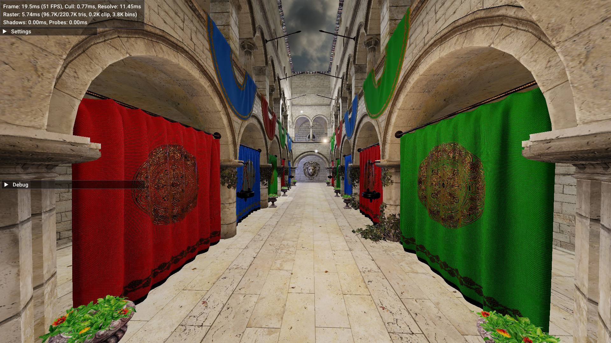
  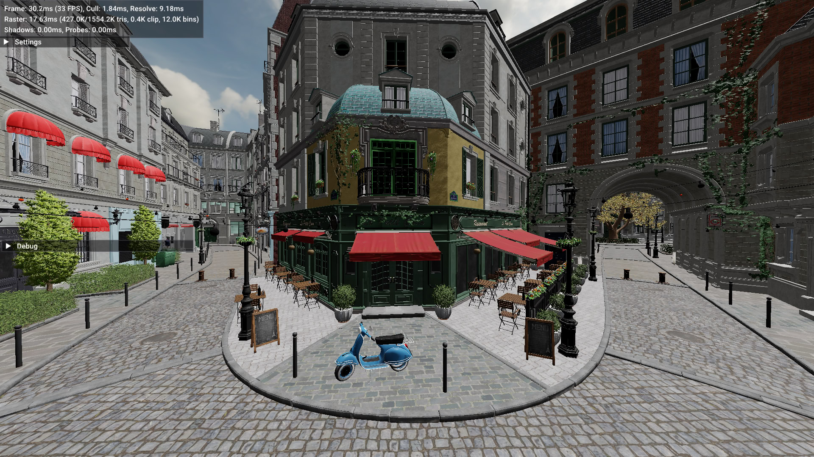
</div>

_Sample screenshots, rendered at 1080p on a 4 core TigerLake CPU, running at 2.8-3.2GHz_


<div>
  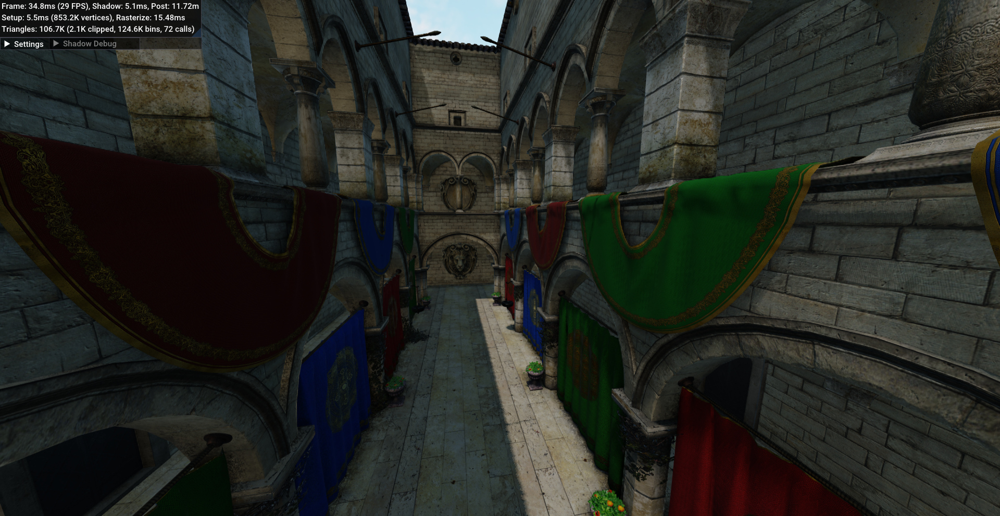
  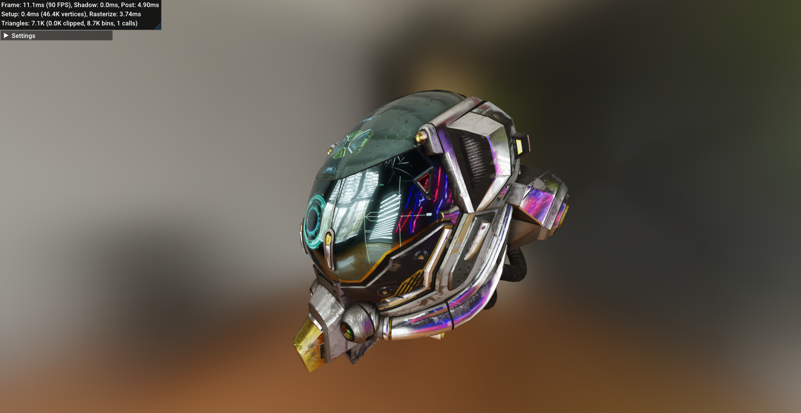
  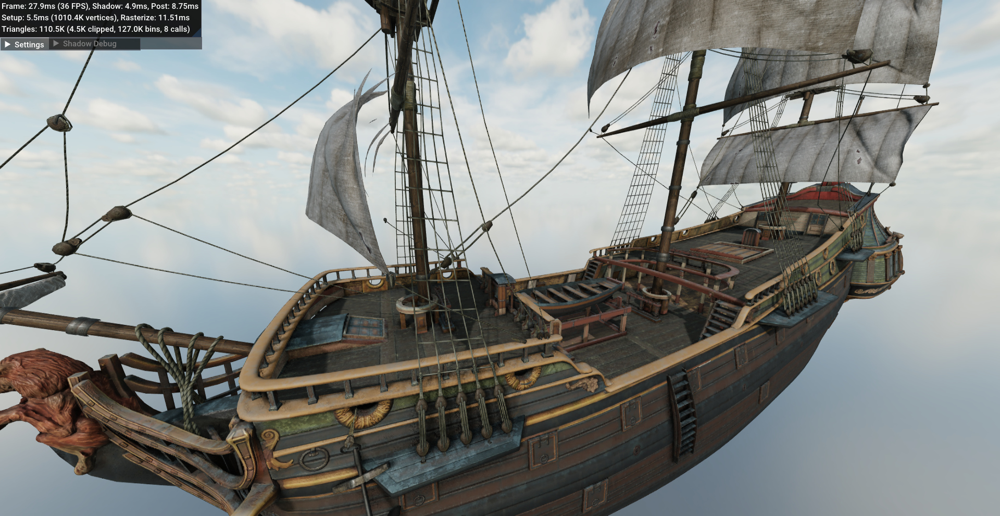
  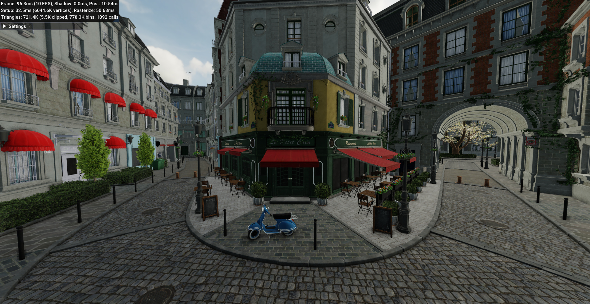
</div>

_Sample screenshots from the [previous version](https://github.com/dubiousconst282/GLimpSW/tree/old-deferred), same config, +TAA, +SSAO, +IBL_


## Implementation Notes
Some things I have and haven't tried.

### Raster Pipeline
Prior the rewrite, the raster pipeline was based around the traditional vertex shader model and was rather poorly optimized. All single-threaded except for bin rasterization and full-screen passes.

One major source of inefficiency was in the lack of shaded vertex reuse based on the index buffer, since finding and referencing duplicates in an efficient way did not seem feasible without fast conflict and gather instructions, therefore the vertex shader would always be invoked three times per triangle. Vertex shading in by itself was also rather expansive because it would spend a lot of time gathering and copying custom attributes, most of which would be immediately thrown away after clipping and culling (typically at least half of all triangles are culled in this early step).

Meshlets are very elegant and enable many interesting optimizations, and in particular they allow for very flexible data layouts. 
This makes it trivial to [avoid gathers](#memory-gathers) in the mesh shader by using an SoA layout, and although the rasterizer still needs to fetch the resulting indexed positions, it can take advantage of the small vertex limit (64) and use the amazing 2-input permute instructions instead, which run over twice as fast as gathers.

Because I had planned to port the renderer to a vis-buffer, and considering the aforementioned inefficiency with custom attributes, they are not supported in the new pipeline. The fragment shader is only given perspective-correct barycentrics, which it can use to interpolate whatever attributes it needs after fetching them from source, as opposed to an intermediate "varying" buffer. Although that is ignoring costlier work for per-model transforms and skinning, which is maybe not a big deal since some games have a dedicated compute pass for skinning.

```cpp
// New pipeline. Produces up to 64 vertices + 128 triangles
void ShadeMeshlet(const ShadingContext& ctx, uint32_t index, swr::ShadedMeshlet& output) {
    const Meshlet& mesh = ctx.Meshlets[index];
    if (CullMeshlet(mesh)) { output.PrimCount = 0; return; }

    // Nice and tight loop, memory bound! (compression could help)
    for (uint32_t i = 0; i < mesh.NumVertices; i += simd::vec_width) {
        v_float3 pos = { simd::load(&mesh.Positions[0][i]), simd::load(&mesh.Positions[1][i]), simd::load(&mesh.Positions[2][i]) };
        output.SetPosition(i, simd::mul(ctx.ObjectToClipMat, v_float4(pos, 1.0f)));
    }
    output.PrimCount = mesh.NumTriangles;
    memcpy(output.Indices, mesh.Indices, sizeof(mesh.Indices));
}

struct Meshlet {
    uint8_t NumVertices, NumTriangles;
    uint32_t MaterialId;

    alignas(64) float Positions[3][64];
    alignas(64) uint8_t Indices[3][128];
    // ...
};

// Old pipeline. Invoked 3 times per 16 triangles (produces 16 vertices)
void ShadeVertices(const swr::VertexReader& data, swr::ShadedVertexPacket& vars) const {
    VFloat3 pos = data.ReadAttribs<VFloat3>(&scene::Vertex::x);       // 3 gathers
    vars.Position = TransformVector(ProjMat, { pos, 1.0f });

    vars.SetAttribs(0, data.ReadAttribs<VFloat2>(&scene::Vertex::u)); // 2 gathers

    VFloat3 norm = data.ReadAttribs<VFloat3>(&scene::Vertex::nx); // snorm8, 1 gather
    vars.SetAttribs(2, TransformNormal(ModelMat, norm));

    VFloat3 tang = data.ReadAttribs<VFloat3>(&scene::Vertex::tx); // snorm8, 1 gather
    vars.SetAttribs(5, TransformNormal(ModelMat, tang));
}
```

The rest of the pipeline is pretty traditional, with a few details I find interesting:

- Clipping
  - Needed to prevent div by `w <= 0` and overflow in fixed-point edge equations (using 32-bit integers and 4-bit subpixel precision, max resolution is 2892x2892 (31/2-4 bits))
  - Packets that are fully inside the viewport are most common due to frustum culling, and accepted immediately (very cheap to test, `max_abs(x,y,z) < w` using `vrangeps`)
  - Otherwise, Cohen-Sutherland outcodes are computed to determine non-trivial triangles. Usually <0.1% tris need actual clipping (guardband is incredibly effective)
  - Clipped triangles go through specialized `DrawTriangle<IsClipped=true>()` function that can adjust shader barycentrics to clipped factors (vertex attribs can't/don't need to be clipped)
- Binning
  - Multi-threading with batch partitioning (for bounded mem usage), and a sort of "scoreboard" for publishing/retiring batches
  - Doesn't preserve draw order (yet/ever), determinism is nice but mainly needed for alpha-blended and 2D stuff
  - Triangle setup is split in two steps to reduce size of binned batches (40 bytes/tri)
    - Early: Perspective div, fixed-point snapping, bounding box, back-face/degenerate culling
    - Late: Edge equations
  - Bins store packet IDs + masks rather than individual triangle IDs, for significantly lower overhead
  - Packets that are contained within a single bin are common (30~60%), slower path loops over entire packet's min/max bounding box, with conservative edge tests for packets spanning >=3x3 bins
- Shader dispatch
  - `DrawTriangle()` is a template specialized over the fragment shader to minimize call overhead/vector reg spills
    - Inner loop does `[[clang::always_inline]] ShaderFn();`. Also lets compiler DCE unused stuff like barycentrics
  - `ShaderDispatchTable` struct carries pointers to the specialized draw function and mesh shaders
    - Instantiation: `shader = swr::GetDispatchTable<&ShadeMeshlet, &ShadePixels>();`
    - Supports multiple fragment shader entry points, which can be changed per meshlet (useful for alpha tested materials)

### DDGI with Voxels

<div align="center"> 
  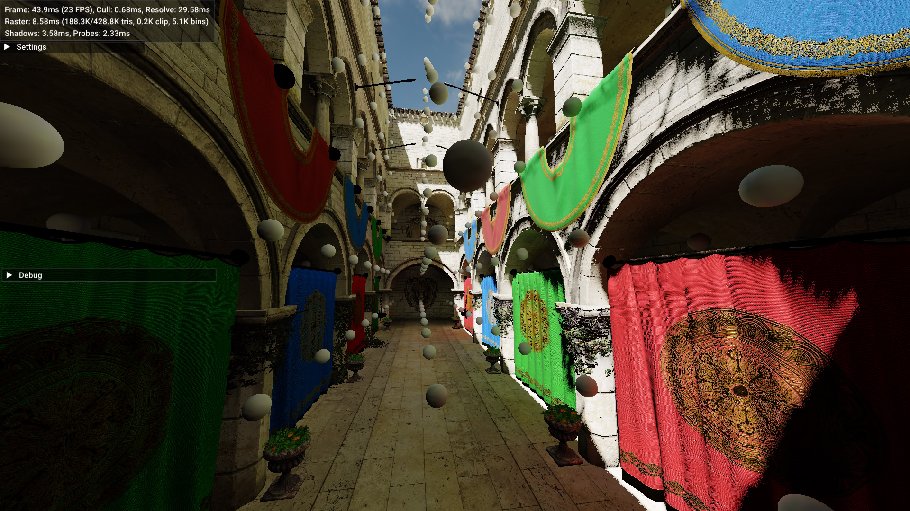
  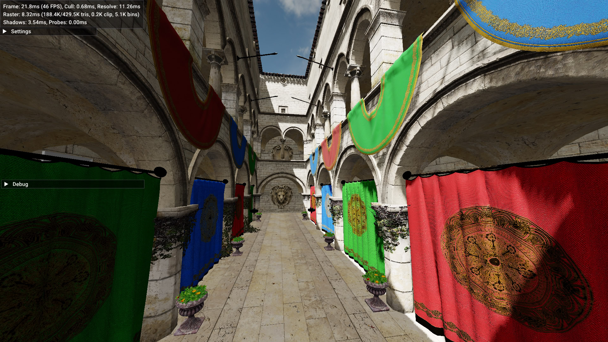
</div>

I wanted to try implement probe-based GI using ray tracing. For that, I decided to use a voxelized representation of the scene, both because past experience and because they are much faster to trace than standard triangle BVHs. Godot actually does the same for SDFGI/HDDAGI, and the results seemed reasonable.

#### Probes
The idea behind DDGI is quite simple, but as usual with graphics techniques the details are devilish. It involves creating a grid of probes which capture irradiance and mean depth around their surfaces, into small octahedron-mapped textures (8x8 irradiance and 16x16 depth for each probe).

To look up irradiance for a given surface, samples from the 8 nearest probes in the grid are weighted and summed (indexing a cage as in trilinear filtering). The irradiance texel is selected by the surface normal, and depth by the direction between the probe and surface. The depth value is used to reduce contribution of probes with no line of sight to the surface, using Chebyshev's inequality test in a similar way as variance shadow maps, as a way to mitigate light leaks.

To update a probe, a small number of rays which are uniformly distributed around a sphere are traced into the world. The resulting hit radiance (shaded surface color) and distances are then convolved by `max(dot(RayDir, TexelDir), 0)` and temporally blended into all probe texels.

Misc notes:
- For reducing leaking: depth convolution sharpening power is VERY important to keep low texel spread (otherwise depth map resolution is wasted), as is the normal/view bias, and clamping ray distance
- Noticeable flickering even at high hysteresis (probably need to stop updating after convergence, TODO: "Scaling DDGI for production")
- Sampling irradiance without billinear can make surfaces look shiny and/or color banded
- Probe convolution is rather expansive (30-40%), pre-computing weights gets it down to ~20%

---

Though ray tracing is obviously very intensive, the main expanse in our case actually comes from sampling and interpolating depth and irradiance texels, which is necessary for acceptable quality. It costs ~18ms at 1080p and 4 threads, over twice the cost of vis-buffer resolve and shading. [TODO: [VRS](https://geometrian.com/data/research/dacs/HPG2018_DeferredAdaptiveComputeShading.pdf)]

#### Voxelization

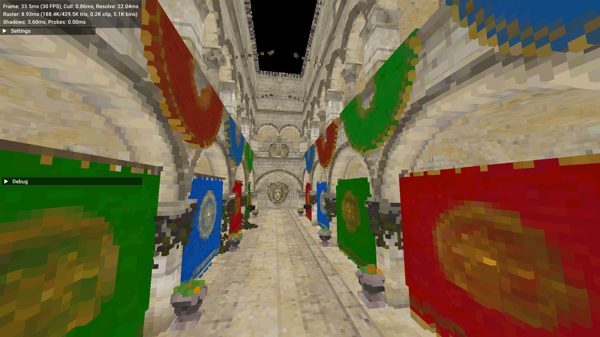

This is very straightforward, just the standard rasterization method using a fragment shader that writes into a 3D grid at the corresponding depth ([good explanation here](https://github.com/BoyBaykiller/IDKEngine#voxel-global-illumination) and [more details here](https://developer.nvidia.com/content/basics-gpu-voxelization)), except those writes go into a bump-allocated brickmap rather than a flat grid. Unexpectedly fast and effective for how simple it is. For Sponza at 512³, the entire process takes 20ms single-threaded and outputs a 24MB intermediate brickmap, which is immediatelly compressed into the accel struct (24MB -> 9MB).

The voxel grid stores surface attributes in 32 bits: albedo (RGB554), normal (10 bit octahedron), and metallic/roughness (4 bits each). This provides good enough quality and avoids the extra cost from having to fetch and interpolate triangle attributes. A limitation is the lack of tie-breaking for triangles that intersect the same voxels, which can result in flipped normals/attributes around thin walls.

---

I ended up adding an extension flag in the rasterizer for swizzling triangles to the dominant axis, because this step would have been difficult to implement in the mesh shader as it could potentially generate up to 3x extra unique vertices, past the 64 output limit. It's a little hacky, but far simpler and more efficient than having a separate swizzling pass, or drawing the geometry 3 times.

There are some occasional gaps in the output, resulting from thin/unaligned triangles that fail to cover samples. This could be fixed with either MSAA or conservative rasterization as described in the Nvidia article, the latter which would be simpler to implement by biasing the edge functions similarly to the accept/reject tile edges used for hierarchical raster. Though probably at a significant cost since it will force every triangle to generate/overdraw samples.

[TODO: clipmap with partial updates]

#### Voxel Ray Tracing
Tinybvh's AVX2 traversal had a throughput of ~7.7M camera and ~17.3M anyhit rays per sec on one thread, Embree's 16-wide packet traversal was a little better at 10-11M rays, but both still much slower than the 18-20M rays my previous brickmap voxel tracer could get up to, and which I thought could still be improved on.

The new voxel tracer runs at around 25-30M camera rays/sec, though probe rays are much slower at 6-7M/sec due to divergence (where a few rays take much longer to finish). I haven't spent much time trying things apart from the obvious premature micro-opts, but that's still somewhat workable. Updating 2048 probes with 64 rays each takes ~6ms on 4 threads, with 20% being spent on convolution.

It uses a compressed brickmap structure which is essentially a sparse contree/64-tree, but with only 3 levels and a flat top-level grid. This removes the need of a stack and long-latency chain of gathers during traversal, is easier to work with, and also more compact, since it can avoid/use smaller leaf node pointers.

The naive SIMT-style packet traversal was up to 8x faster than scalar in early tests, though this model is typically suboptimal in the case of BVHs, as they are far more divergent-ey and memory intensive, whereas voxel occupancy is reasonably compact.

### Virtual Shadow Maps (at home)

<div align="center">
  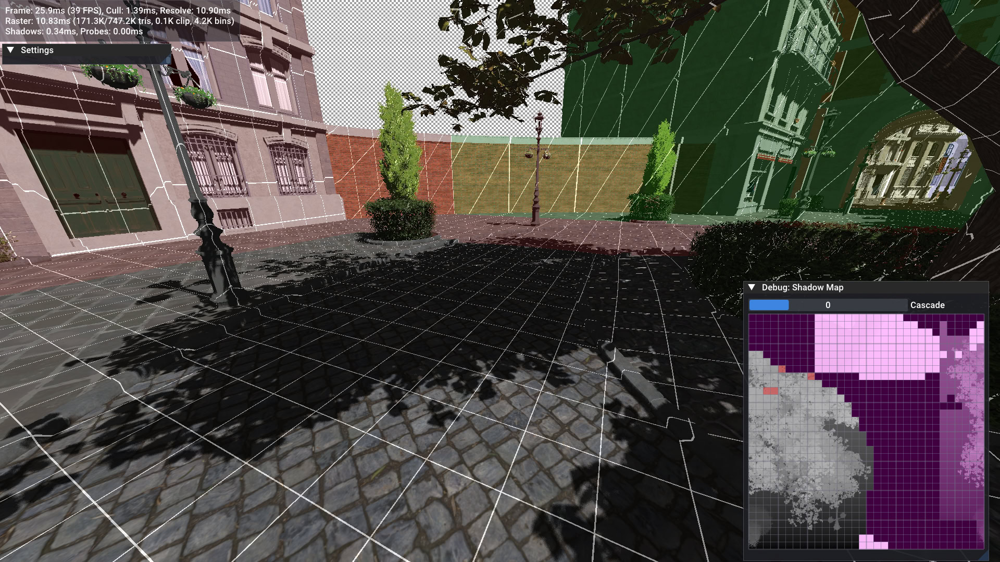
</div>

While traditional Cascaded Shadow Maps can provide reasonable quality and performance on GPUs, rendering the scene several times per frame is a huge expanse given our bandwidth constraints. Worse is that there seems to be no good way to cache them without sacrificing resolution and having to eventually invalidate and redraw them entirely.

Virtual Shadow Maps are an interesting approach that improves on both quality and performance, where the shadow map is broken up into small clipmapped chunks or "pages", which are dynamically allocated and rendered for world regions that are visible from the camera's perspective. This allows for better control over resolution, reduced memory usage, fine-grained culling, and caching (so as long as the light direction doesn't change).

For the sake of simplicity, I have not implemented sparse memory allocation, and instead each cascade is allocated as a single continuous texture layer. Doing so with mmap could be interesting (mapping one page = one tex layer to keep addressing simple), but I was primarily concerned with the performance prospects. Additionally due to performance and rasterizer limits, cascades can be at most 2048x2048, so overall memory usage/waste cannot grow significantly.

TODO: write about perf (~free if camera is static or moves slowly, but probably can't amortize full inval with a single global matrix (stutters))

#### Cascade Projection
There are multiple ways to select cascades, with varying tradeoffs. [J. Stephano](https://ktstephano.github.io/rendering/stratusgfx/svsm#selecting-clipmaps) proposes using the log2 magnitude of projected NDC coordinates, whereas [M. Sakmary](https://github.com/MatejSakmary/VSM_masters_thesis/blob/main/VSM_Thesis.pdf) proposes screen-space footprints computed via ray differencials to achieve a finer pixel->texel mapping. I opted for the first approach, because it is cheap and maximizes use of the cascade's depth map.

One problem from using a single origin for all cascades is that pages at upper levels may lie on fractional increments, which may require all pages to be invalidated when the clipmap shifts with camera movement. To solve this without introducing per-cascade matrices, snapping offsets are pre-computed and applied in NDC space after the initial projection, similarly to CSM texel snapping.

Finally, the projection matrix used for rendering higher cascade levels can be computed by scaling the base cascade matrix (all XY columns) and snapping translation to page boundaries.

```cpp
float stepSize = DepthBuffer->Width / float(PageSize << level) * 0.5f;
float2 snapOffset = glm::fract(float2(ProjMatrix[3]) * stepSize) / stepSize;

if (level == 0) {
    // Add view offset in cascade space to avoid changing depth range
    float2 viewOffset = float2(ProjMatrix * float4(viewPos, 1));
    snapOffset += glm::floor((viewOffset - snapOffset) * stepSize) / stepSize;

    ProjMatrix[3][0] -= snapOffset.x;
    ProjMatrix[3][1] -= snapOffset.y;

    SnapOffset[level] = 0;
} else {
    SnapOffset[level] = -snapOffset;
}
```

```cpp
ShadowClipmap::PageLoc ShadowClipmap::Project(v_float3 worldPos) {
    v_float4 ndc = simd::mul(ProjMatrix, v_float4(worldPos, 1));  // div not needed for ortho

    v_int level = simd::clamp(simd::ilog2(simd::max_abs(ndc.x, ndc.y)) + 1, 0, MaxCascades - 1);
    v_float2 uv = v_float2(ndc) + SnapOffset[level];

    simd_if(simd::ilog2(simd::max_abs(uv.x, uv.y)) >= level) { // fixup unaligned cascade overlap
        level += v_exec ? 1 : 0;
        uv = v_float2(ndc) + SnapOffset[level];
    }
    v_float levelScale = simd::as<v_float>(simd::as<int>(ScaleUV) - (level << 23));  // ScaleUV * (2^-level)
    v_int2 texelPos = simd::conv<int>(uv * levelScale + ScaleUV);
    texelPos = (texelPos - (v_int2(PageWrapOffset) >> level) * PageSize) & PageWrapMask;

    return { texelPos, level, ndc.z };
}
```

#### Page Marking
The very first step is marking pages that are visible, by unprojecting the rendered scene's depth buffer and back into the shadow map. To minimize cost, I used the half-resolution buffer from the Hi-Z downsampling pass that is generated for occlusion culling. This takes 250-300us at 1080p and 4 threads.

At first I considered allocating one bitmap per thread to avoid the devastating cost of atomics, but roughly deduplicating page indices over 8x8 blocks using `vpcompressd` and branching over already marked bits made this cost negligible, with projection and memory bandwidth becoming the limiting factors. (This is an useful optimization I have used before for marking active probes, and other projects like GPU hash map lookup/insert. It should work even under weaker memory models, as stale values will eventually converge.)

```cpp
    if ((*bitmap & mask) == 0) __atomic_fetch_or(bitmap, mask, __ATOMIC_RELAXED);
```

#### Page Rendering
The entire scene is drawn from the light's perspective as usual, with two important changes: the fragment shader must offset/wrap pixel coords into the proper page location before writing to the depth buffer, and meshlets that don't span invalid _and_ visible pages should be culled to improve performance.

On a GPU implementation, such a fragment shader needs to bypass the usual framebuffer output mechanism in place of image atomics, which might also disable HW optimizations like early-Z and compression (though that's [maybe avoidable](https://therealmjp.github.io/posts/to-earlyz-or-not-to-earlyz/#rasterizer-order-viewsfragment-shader-interlock)). This is a very trivial change in our case, because shaders are responsible for framebuffer accesses and depth testing, and invocations within a bin are always serial. (TODO: "triangle setup shader" so bin coords can be offset once instead of per frag)

Page culling can be optimized by querying mipmaps of the bitmap (generated with OR-reduction) depending on the projected bound rect size, similarly to Hi-Z occlusion culling. In practice, I found that looping over the full bitmap, checking rows by ANDing with a span-mask and early bail is also acceptably fast.

```cpp
// [...a..b.]  (case 1, continuous)
// [..b..a..]  (case 2, wrap)
v_int pageX0 = (x0 - pageWrapOffset.x) & pageWrapMask;
v_int pageX1 = (x1 - pageWrapOffset.x) & pageWrapMask;
v_int rowMask = (~0 << pageX0) ^ (~1 << pageX1) ^ (pageX0 > pageX1 ? ~0 : 0);
```

---

Despite culling, some meshlets may contain large triangles that span over many unmarked pages, and cause unnecessary overdraw. To combat this, I initially thought of extending the rasterizer to accept per-meshlet scissor rects, but found that a "stencil" bitmap at bin granularity was simpler and more elegant, perfect in fact. Trivial to derive from the dirty page bitmap, and the actual change was a one-liner that adds practically no overhead, as the binner already generates masks to accelerate search of filled bins when commiting batches.

```diff cpp
    for (uint32_t i = 0; i < _queue->BinsPerFrame; i += 64) {
        auto counts = simd::load<uint8_t, 64>(&batch->Counts[i]);
        uint64_t mask = simd::movemask(counts != 0);

+       if (EnableBinStencil) mask &= BinStencilMask[i / 64u];
        batch->Bitmap[i / 64u] = mask;
```

### Vis-buffer
The renderer uses a [visibility buffer](https://filmicworlds.com/blog/visibility-buffer-rendering-with-material-graphs/) to mitigate overdraw and poor quad utilization, where the fragment shader writes only the triangle ID, and all attribute fetch and shading is performed in a separate resolve pass.

The resolve pass is very expansive as it needs to fetch and intersect triangles for attribute interpolation. It does not payoff for simple scenes, but the cost varies relatively little as scene complexity grows.

#### Triangle Intersection
A slightly more efficient way to intersect triangles in clip space is described in ["Triangle Scan Conversion using 2D Homogeneous Coordinates"](https://userpages.cs.umbc.edu/olano/papers/2dh-tri) by Olano and Greer. The following costs ~ 50 FLOPs compared to 70 in the snippet from John Hable's article, which sped resolve by 3-5%.

```hlsl
// Given a triangle in homogeneous space (before persp div), returns barycentrics
// and derivatives at given screen coords [-1..+1]. Then, to interpolate `a`:
//     a = a0*(1-u-v) + a1*u + a2*v
//       = a0 + (a1-a0)*u + (a2-a0)*v
//     ddx(a) = (a1-a0)*dx_u + (a2-a0)*dx_v
//     ddy(a) = (a1-a0)*dy_u + (a2-a0)*dy_v
// https://userpages.cs.umbc.edu/olano/papers/2dh-tri
// https://www.cs.umd.edu/~zwicker/courses/computergraphics/Homogeneous_rasterization.pdf
void IntersectTriangle(float4 v0, float4 v1, float4 v2, float2 screenNdc, float2 screenSize,
                       out float2 uv, out float2 dx_uv, out float2 dy_uv) {
    float3 m0 = cross(v2.xyw, v0.xyw);
    float3 m1 = cross(v0.xyw, v1.xyw);
    float3 m2 = cross(v1.xyw, v2.xyw);

    float3 w = m0 + m1 + m2;
    float3 e0 = float3(m0.x, m1.x, w.x);
    float3 e1 = float3(m0.y, m1.y, w.y);
    float3 e2 = float3(m0.z, m1.z, w.z);

    float2 dd = 2.0 / screenSize;   // (may need to negate Y)
    float3 a00 = screenPos.x * e0 + screenPos.y * e1 + e2;
    float3 a10 = a00 + dd.x * e0;
    float3 a01 = a00 + dd.y * e1;

    uv = a00.xy * rcp(a00.z);
    dx_uv = a10.xy * rcp(a10.z) - uv;
    dy_uv = a01.xy * rcp(a01.z) - uv;
}
```

#### Triangle Attrib Cache

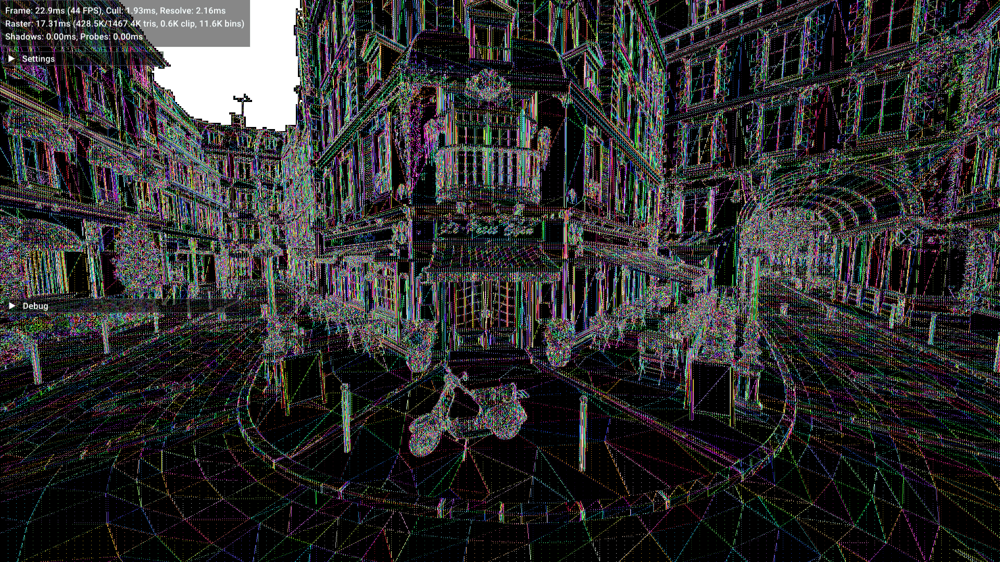

As a way to reduce the number of vertex fetches and transforms, I tried to implement triangle caching using a simple RLE compression scheme based on the compress/expand instructions.

It reduces the number of triangles to be fetched by 3-7x on Bistro and Sponza, and speeds overall resolve by 8-16% (1.1-0.7ms at 4 threads). I decided not to merge it for now, because it introduces variability and the savings seem relatively small for the added boilerplate, but could be interesting for skinning/animations.

---

The first step is generating masks that marks indices where adjacent values change, by comparing a vector with a shifted version of itself (or rather, offset loads appear to be slightly faster despite the split-line penalty). Then, attributes for triangles in the compacted buffer are fetched and placed into the cache. 16x8 pixel blocks are processed in isolation to limit output (~9KB) and keep it warm in CPU cache.

```cpp
v_uint s0 = simd::load(tileData + 0);
uint16_t prefixMask = _mm512_cmpneq_epi32_mask(s0, simd::load(tileData + 1));
simd::store(&compactIds[surfaceCount], _mm512_maskz_compress_epi32(prefixMask, s0));
surfaceCount += simd::popcnt(prefixMask);
```

For lookup, the `vpexpand` instruction behaves almost exactly like what we need, but zeroes lanes at unset mask bits instead of filling. Computing the proper permute indices is fortunately very cheap using a lanewise prefix popcount, and only needs to be done once per tile (it'd be [much harder](https://stackoverflow.com/q/36932240) for compress if the instruction didn't exist, since there's no scatter_permute). This actually ends up being cheaper since both Intel and AMD implement the compress/expand instructions through an internal uop followed by permute (as implied by uops.info), which we can now nicely avoid.

```cpp
uint16_t prefixMask = uint16_t(cache.PrefixMask[blockPos.y / 4] >> (blockPos.x / 4 * 16));
v_uint cacheIdx = simd::popcnt(prefixMask & ((1u << simd::lane_idx<v_uint>) - 1));

attrib0 = _mm512_permutexvar_epi32(cacheIdx, simd::load(&cache.Attrib0[cacheOffset]));
attrib1 = _mm512_permutexvar_epi32(cacheIdx, simd::load(&cache.Attrib1[cacheOffset]));
// ...

cacheOffset += simd::popcnt(prefixMask);
```

#### Performance
The following benchmark with a G-buffer shader mock up (2x tex sample + normal mapping + 96-bit write out. single-thread, 1080p). The G-buffer timings only include rasterization, whereas vis-buffer also include resolve+shading (as annotated). Estimated shading cost is 4.5-7ms. Ultimately not very impressive, though the current vis-buffer implementation is not particularly clever and probably has room for some cost cutting (TAA/VRS).

(TODO: rerun with new opts)

|us/frame|frame/s |    err% |       ins/frame |       cyc/frame |    IPC | #tris| benchmark
|-------:|-------:|--------:|----------------:|----------------:|-------:|-----:|:----------
|  2,089 | 478.57 |    0.5% |    5,273,435.50 |    4,969,507.00 |  1.061 |    3 | `FSQuad` Vis Rast
| 37,875 |  26.40 |    0.2% |  127,637,231.00 |   90,954,890.00 |  1.403 |    3 | `FSQuad` Vis Rast+Resolve
| 18,695 |  53.49 |    0.3% |   62,854,820.83 |   44,614,039.17 |  1.409 |    3 | `FSQuad` GBuffer Rast
| |
| 16,234 |  61.60 |    0.3% |   56,256,280.88 |   38,756,962.29 |  1.452 | 101k | `Sponza` Vis Rast
| 55,272 |  18.09 |    0.2% |  176,972,226.50 |  132,081,917.50 |  1.340 | 101k | `Sponza` Vis Rast+Resolve
| 51,701 |  19.34 |    0.3% |  178,413,704.00 |  123,338,020.00 |  1.447 | 101k | `Sponza` GBuffer Rast
| |
| 77,904 |  12.84 |    0.3% |  272,403,046.50 |  185,800,322.50 |  1.466 | 574k | `Bistro` Vis Rast
|121,624 |   8.22 |    0.2% |  400,114,530.50 |  290,217,947.50 |  1.379 | 574k | `Bistro` Vis Rast+Resolve
|130,462 |   7.67 |    0.2% |  472,210,218.50 |  311,326,665.00 |  1.517 | 574k | `Bistro` GBuffer Rast

Resolve profile summary for Bistro:
- 83%: ResolveSurface
  - 22%: Gather vertex attribs
  - 17%: Transform, project, intersect triangles
  - 26%: Sample textures (albedo + packed normal_mr)
  - 12%: Unpack and texture-map normals
- 9%: EvalLighting (for one directional light)

### Rasterizer Micro-opts
The performance profile between small and large triangles is obviously very different.

Initially, most of the time will be spent fetching framebuffer data from RAM, in particular for depth tests. Fast clears could help, but unfortunately there seems to be [no way](https://blogs.fau.de/hager/archives/8997) to populate the cache without having the CPU fetch associated data from RAM, even for aligned and unmasked 512-bit stores that completely overwrite cachelines, due to the "read for ownership" [cache coherence](https://fgiesen.wordpress.com/2014/07/07/cache-coherency/) transaction. Although it may still be possible to save one memory trip by delaying and splitting framebuffer clears to the first bin rasterization step. [TODO]

Small triangles spend most of the time going through the overall pipeline, when ultimately they will only cover a few pixels.

As noted in [CudaRast11](https://research.nvidia.com/publication/2011-08_high-performance-software-rasterization-gpus), many small triangles fall in between samples and thus have no coverage, and can be culled early with a bounding box test. A mistake that made this ineffective was aligning the bounding box to 4x4 pixels, which wasted 9% of time on Bistro.

They also incur less predictable branches (and lower ipc due to bad spec? and/or maybe fewer oooe opportunities) in traversal due to varying sizes and alignment, though the overall impact seems to be relatively small (~9% mispreds). It's not obvious how this could be avoided efficiently, perhaps short of dispatching specialized/unrolled rasterizers based on triangle sizes (similar to [CuRast26](https://github.com/m-schuetz/CuRast)). Hierarchical traversal might be less susceptible to mispreds, ignoring setup overhead, since traversal can simply loop over set bits in the tile coverage mask.

<div align="center">
  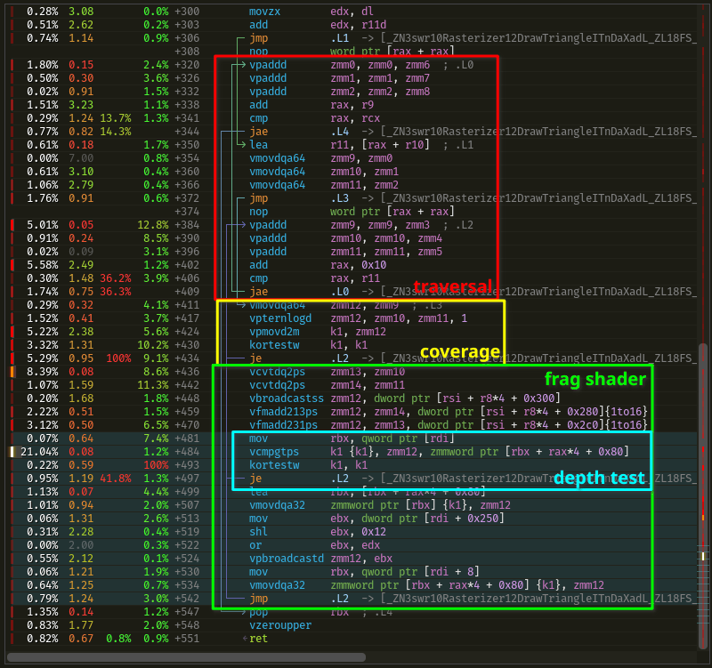
  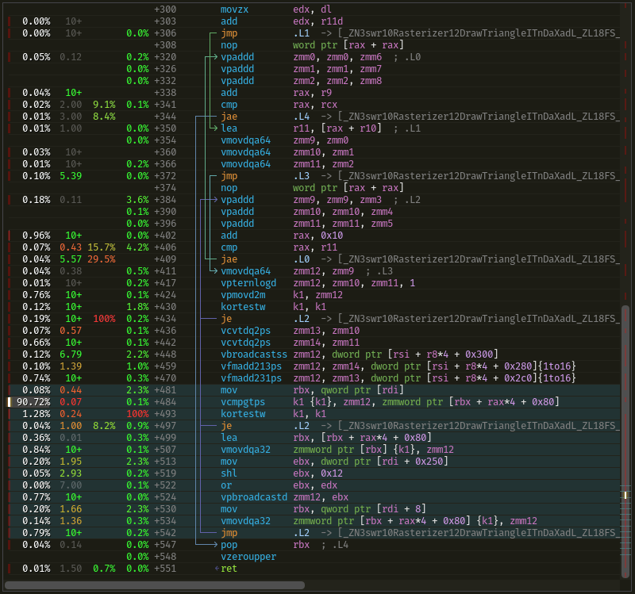
  
_Disassembly and Tracy profile for Bistro, vs. uniform grid of quads (~340x340 pixels across)_
</div>

Annoyingly, Clang fails to hoist the vis-buffer instance ID and other values from the fragment shader, which I suspect may be to due to false aliasing checks with framebuffer writes. There doesn't seem to be a simple and reliable way to influence this, as support for __restrict attributes is very limited.

#### Traversal
To minimize traversal cost for larger triangles, where most part of the bounding box is empty, the binned rasterizer performs conservative edge tests for triangles that span more than a few bins (>128x128 pixels), which saves around 3-18% from raster time depending on the scene. This was more effective than some of the smarter [scan/hierarchical traversal algorithms](https://fgiesen.wordpress.com/2011/07/06/a-trip-through-the-graphics-pipeline-2011-part-6/), as it avoids [overhead](./src/SwRast/Benchmarks/CoarseRaster.cpp) for small triangles while adding very little complexity to the pipeline.

---

Deriving the third edge distance through `u = 1 - v - w` in the rasterizer loop was considered as a way to save setup and registers, at the cost of one extra add per pixel (or rather, latency). The coverage test can be rewritten like the following to break the dependency chain, though this is not actually benefitial on TigerLake because it can only dispatch one compare per cycle, which limits the inner loop throughput to at least >1/2 cycles. For the uniform mesh of small quads (4x4 pixel across), this provided a ~5% speedup, but had a slight negative result for real geometry.

```cpp
    v_int edgeNorm = edgeOrigin.x + edgeOrigin.y + edgeOrigin.z; // triangle area (invariant)

    v_mask edgeMaskYZ = _mm512_movepi32_mask(edge.y | edge.z);                // or, add
    v_mask edgeMaskX = _mm512_cmple_epi32_mask(edge.y + edge.z, edgeNorm);    // movd2m, cmp
    if (!_ktestc_mask16_u8(edgeMaskYZ, edgeMaskX)) {                          // ktest
        asm("" : "+Yk"(edgeMaskYZ), "+Yk"(edgeMaskX));
        vars.TileMask = _mm512_kandn(edgeMaskYZ, edgeMaskX);
```

#### Quad Utilization
The rasterizer maps the 16 SIMD lanes into 4x4 pixel fragments. This works reasonably well, but suffers from the characteristic quad utilization problem, where small triangles cover very few lanes, in addition to the already high setup overhead.

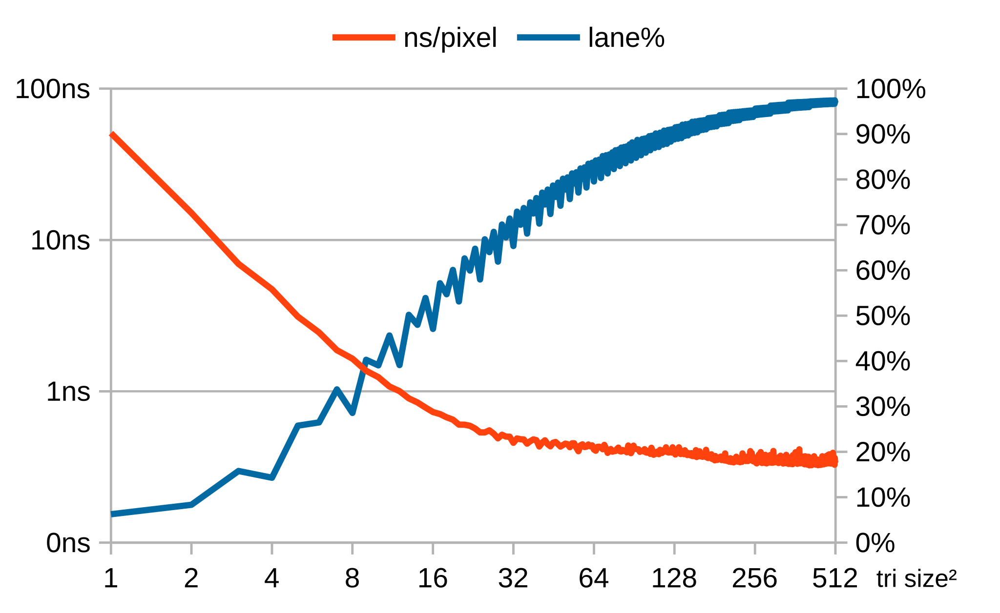

The chart shows the average pixel cost and percent of active lanes when rendering an uniform grid of quads at NxN size, indicating that drawing cost starts high but grows almost linearly past 70% lane usage. On Sponza, the typical number of fragments at 1080p ranges between 6.4-11.5M, with 66-73% lane usage before the depth test, and afterwards 4.7-5.8M fragments with 58-62% lane usage.

An experiment rasterizing multiple small triangles (<= 4x4 pixels) using gather/scatter instructions per pixel showed relatively small improvements in real test scenes: ~ 3.5% for Sponza, 4% for Bistro, -2.8% for 4x4 quads, 76% for 1x1~2x2 quads. There was no attempt to resolve conflicting writes to the same pixel, which would likely have added considerable cost.

### Binning and Load Balancing
TBW
  - Efficient load balancing has been a major undertaking
    - Current approach is up to ~20% slower than immediate due to stalls, still lots of ideas to experiment with
    - Batching worsens it, but allows for constant memory usage (bandwidth is expansive, but maybe still a better tradeoff?)
    - Initially tried switching all threads between mesh and raster stages with global barriers. Was up to 1.7x slower, because some bins take much longer to rasterize and cause other threads to stall for a long time 
  - [Static bin pattern](https://schmalstieg.github.io/pdf/Schmalstieg_338.pdf), worker threads rasterize every Nth bin
  - Fixed number of batches, dynamically reserved by binners. Scoreboard is an array of per-batch statuses, unused(0)|reserved(~0)|committed(pending_mask). The pending_mask flags workers that are pending raster, which is progressively cleared after each (so bins are only rasterized once), until the batch becomes unused, when it can be reserved again for binning

### Memory Gathers
Memory gathers are fundamental for general SIMT-style programming, but they are not well accelerated on current x86 CPUs and always scalarized to one memory access per lane, providing significantly lower throughput compared to sequential vector loads when the data is well localized in cache. In some cases, they can be avoided in place of more efficient sequences using in-register permutes.

---

For gathering values from a small array (64 elements), replacing gathers with loads + permutes provides a ~2.2x speedup. This is used to load clip-space positions output from the mesh shader. [GatherSmall.cpp](./src/SwRast/Benchmarks/GatherSmall.cpp)

```cpp
static v_float GatherPreload64(const float data[64], v_int idx) {
    v_float v0 = _mm512_load_ps(&data[0]);
    v_float v1 = _mm512_load_ps(&data[16]);
    v_float v2 = _mm512_load_ps(&data[32]);
    v_float v3 = _mm512_load_ps(&data[48]);
    v_float p01 = _mm512_permutex2var_ps(v0, idx, v1);
    v_float p23 = _mm512_permutex2var_ps(v2, idx, v3);
    return idx < 32 ? p01 : p23;
}
```

---

For adjacent accesses multiple of 2 x 32-bit components, 64-bit gathers combined with permutes are ~1.6x faster. [GatherThroughput.cpp](./src/SwRast/Benchmarks/GatherThroughput.cpp) [TexGather64.cpp](./src/SwRast/Benchmarks/TexGather64.cpp)

```cpp
auto lo = _mm512_i32gather_epi64(_mm512_extracti32x8_epi32(idx, 0), ptr, 4);
auto hi = _mm512_i32gather_epi64(_mm512_extracti32x8_epi32(idx, 1), ptr, 4);
auto x = _mm512_permutex2var_epi32(lo, lane_idx<v_int> * 2 + 0, hi);
auto y = _mm512_permutex2var_epi32(lo, lane_idx<v_int> * 2 + 1, hi);
```

---

For gathering multiple fields where duplicate indices are common, fetching unique lanes one at a time using a "waterfall/cascade" loop can be more efficient, since gathers have a significant and constant minimum cost. On Bistro, the vis-buffer resolve pass peaks at an average of 3.7 different triangles per 4x4 pixels, which shows this is worthwhile even for reasonably detailed scenes. [GatherMany.cpp](./src/SwRast/Benchmarks/GatherMany.cpp)

```cpp
v_int surfaceId = simd::load(tileData);

for (v_mask pendingMask = activeMask; pendingMask != 0;) {
    uint32_t surfaceId_i = tileData[simd::tzcnt(pendingMask)];

    v_int iterMask = (surfaceId == surfaceId_i);
    pendingMask &= ~simd::movemask(iterMask);

    const Meshlet& mesh = ctx.Meshlets[surfaceId_i / swr::ShadedMeshlet::MaxPrims];
    uint32_t i0 = mesh.Indices[0][surfaceId_i % swr::ShadedMeshlet::MaxPrims];
    simd::cmov(pos[0].x, mesh.Positions[0][i0], iterMask);  // `vbroadcastss zmm {k}, [mem]`
    simd::cmov(pos[0].y, mesh.Positions[1][i0], iterMask);
    simd::cmov(pos[0].z, mesh.Positions[2][i0], iterMask);
}
```

Time(ns) to gather Y fields from X unique indices:

| Method     | 1   | 2   | 3   | 4   | 5   |**6**| 7   | 8   | 9   | 10  | 11  | 12  | 13  | 14  | 15  |
| ------     |-----|-----|-----|-----|-----|-----|-----|-----|-----|-----|-----|-----|-----|-----|-----|
| Gather x4  |21.67|21.64|21.66|21.58|21.59|21.60|21.60|21.58|21.61|21.60|21.64|21.71|21.70|21.72|21.73|
| Cascade x4 |4.50 |6.62 |9.46 |13.01|16.80|21.15|28.38|32.88|38.06|43.86|48.93|55.66|63.15|69.65|79.88|
| Gather x8  |37.12|37.11|37.15|37.15|37.08|36.95|36.90|36.98|37.03|36.91|36.94|36.93|37.00|36.95|36.93|
| Cascade x8 |7.06 |11.17|15.70|19.88|25.08|31.07|38.34|46.75|56.64|64.52|73.25|81.55|89.81|100.13|110.46|

---

When the Gather Data Sampling vulnerability mitigation is enabled on TigerLake, gather throughput is reduced by over 3x, which slows down the renderer noticeably. On Linux, it can be disabled by booting with kernel parameter `mitigations=off` or `gather_data_sampling=off`. [GatherThroughput.cpp](./src/SwRast/Benchmarks/GatherThroughput.cpp)

default
|               ns/op |                op/s |    err% |          ins/op |          cyc/op |    IPC | benchmark
|--------------------:|--------------------:|--------:|----------------:|----------------:|-------:|:----------
|              121.69 |        8,217,937.67 |    1.3% |        1,230.00 |          302.42 |  4.067 | `Load_Scalar_32`
|               18.70 |       53,467,269.08 |    0.7% |          171.00 |           46.36 |  3.688 | `Load_AVX2`
|               18.69 |       53,495,847.79 |    0.3% |           97.00 |           46.46 |  2.088 | `Load_AVX512`
|              410.49 |        2,436,102.25 |    0.6% |          294.00 |        1,018.32 |  0.289 | `Gather32_AVX512`

mitigations=off
|               ns/op |                op/s |    err% |          ins/op |          cyc/op |    IPC | benchmark
|--------------------:|--------------------:|--------:|----------------:|----------------:|-------:|:----------
|              120.67 |        8,287,178.49 |    0.6% |        1,230.00 |          299.41 |  4.108 | `Load_Scalar_32`
|               30.60 |       32,684,184.90 |    0.7% |          171.00 |           76.03 |  2.249 | `Load_AVX2`
|               18.66 |       53,602,141.29 |    0.3% |           97.00 |           46.34 |  2.093 | `Load_AVX512`
|              135.25 |        7,393,699.75 |    0.5% |          294.00 |          336.43 |  0.874 | `Gather32_AVX512`
|               78.83 |       12,685,063.34 |    0.7% |          295.00 |          196.10 |  1.504 | `Gather64_AVX512`

### Texture Sampling
Mip-mapping improves sampling performance significantly thanks to better cache locality and reduced memory bandwidth. In the fragment shader, screen-space derivatives can be easily approximated through finite difference of SIMD lanes, exactly as done by GPUs.

For RGBA8 textures, bilinear interpolation is done in 16-bit fixed-point using `_mm512_mulhrs_epi16()`, operating on 2 channels at once. It costs about 2.5x more than nearest sampling, so the shader switches between bilinear for magnification and nearest+nearest mipmap for minification at the fragment level. This hybrid filtering turns to be quite effective because most samples fall on lower mips around distant objects, and the aliasing introduced by nearest sampling is relatively subtle, although the lack of trilinear filtering can be noticeable.

A micro-optimization for sampling multiple textures of the same size is to pack them into a single layered texture, which can be implemented essentially for free using a single offset. When sample() calls are inlined (many functions are marked as `always_inline` to avoid stack spills of vector registers), the compiler can [eliminate](https://en.wikipedia.org/wiki/Common_subexpression_elimination) duplicated UV setup for all of those calls (wrapping, scaling, rounding, and mip selection), since it can more easily prove that all layers have the same size. This is currently done for the BaseColor + NormalMap/MetallicRoughness + Emission textures, and saves about 3-5% from rasterization time [old numbers].

### Texture Swizzling
With the traditional row-major layout `x + y * stride`, texture accesses along the X and Y axis have dramatically different performance caracteristics due to cache locality. This is problematic for 3D rendering, since samples relative to object surfaces which are arbitrarily transformed by shear and rotations will often straddle across rows. GPUs have historically used swizzled/tiled layouts to improve spatial locality and minimize this issue.

In my experiments, tiling provided relatively small improvements outside of artificial throughput benchmarks. After mip-mapping, sampling appears to get bound primarily by overall compute latency, rather than memory. [TexSwizzle.cpp](./src/SwRast/Benchmarks/TexSwizzle.cpp)

<div align="center">
  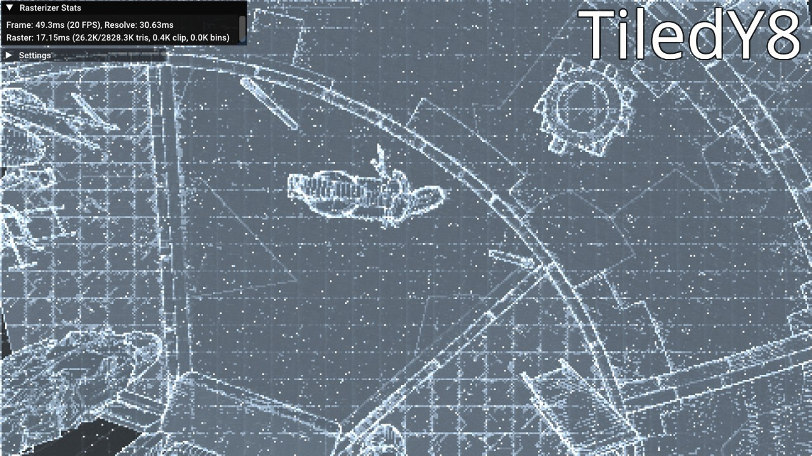
  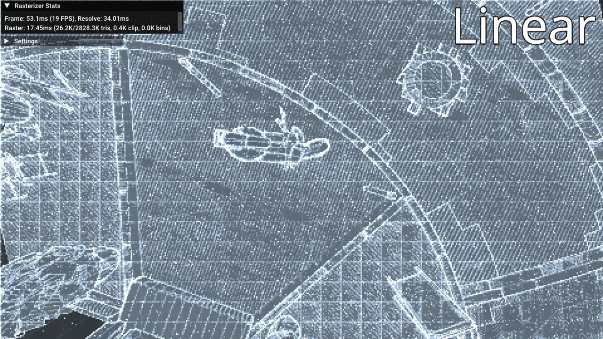
  <br><i>Plot of pixel exec timings</i>
</div>

Benchmark: Sampling visible fragments on Bistro (same camera view as in screenshot above; this is one of the more extreme cases, the difference for most other views is much lower)

| relative | us/frame | frame/s |    err% |       ins/frame |       cyc/frame |    IPC |  L1 cache refs |L1 miss% |  L3 cache refs |L3 miss% | benchmark
|---------:|---------:|--------:|--------:|----------------:|----------------:|-------:|---------------:|--------:|---------------:|--------:|:----------
|   100.0% | 7,663.88 |  130.48 |    0.4% |    6,950,779.37 |    7,896,070.00 |  0.880 |  1,561,448.982 | 45.517% |    510,678.795 | 39.582% | `Linear`
|   109.6% | 6,994.87 |  142.96 |    0.2% |    7,108,171.15 |    7,130,771.74 |  0.997 |  1,525,567.214 | 30.913% |    412,985.321 | 44.510% | `TiledY4`
|   119.5% | 6,413.49 |  155.92 |    0.2% |    7,200,482.11 |    6,486,365.35 |  1.110 |  1,539,443.778 | 36.232% |    461,749.667 | 38.448% | `TiledY8`
|   110.4% | 6,942.70 |  144.04 |    0.2% |    7,651,839.90 |    7,107,611.88 |  1.077 |  1,557,348.420 | 35.117% |    448,449.236 | 38.333% | `Tiled16X4`
|   104.6% | 7,330.19 |  136.42 |    0.2% |    7,534,736.43 |    7,485,451.07 |  1.007 |  1,450,118.143 | 39.071% |    469,501.688 | 37.637% | `ZCurve`

Benchmark: Sampling a 4096x4096 texture, row by row, with some fixed rotation and scale (million samples/sec)

| Layout   | 0deg   | 45deg  | 90deg  |
| -------- | ----   | -----  | -----  |
| Linear   | 1364.59| 353.89 | 241.10 |
| TiledY4  |  802.55| 424.05 | 332.89 |
| TiledY8  |  668.19| 470.65 | 398.59 |
| Tiled16X4|  662.45| 448.10 | 451.42 |
| ZCurve   |  654.92| 407.36 | 469.11 |

The TiledY4 and TiledY8 layouts swizzle across 4x4 and 8x8 pixel tiles respectively. Tiled16X4 swizzles across two-levels, 16x16 and 4x4. The indexing formula has been simplified by placing pixels in column-major order, as described in [fatmap.txt](https://www.flipcode.com/documents/fatmap.txt): `(y & 7) | (x << 3) | ((y & ~7) << stride)` (3 cycles latency).

It is a bit surprising that 8x8 tiling outperforms 4x4, considering each 4x4 tile maps into exactly one cacheline. This appears to be largely related to the hardware prefetcher and TLB misses (perf stat reports ~36% fewer unused prefetches, ~32% fewer TLB misses). The wider 16x4 swizzle slightly reduces TLB and prefetch misses further, but increases "cycle_activity.stalls_mem_any" by 12% for some undetermined reason.

TODO: Measure impact of huge pages. Seems like texture allocs are implicitly promoted to 2MB pages via THP, but only on a fresh boot

### Compiler optimization barriers
Clang absolutely loves canonicalizing and folding things, which is convenient but sometimes pessimizes the input. Empty inline asm blocks can be used to a steer towards certain outputs given some trial and error. The trick is in choosing a proper read/write [operand constraint](https://gcc.gnu.org/onlinedocs/gcc/Extended-Asm.html) to obscure the value's def-chain without worse side effects. Without the volatile modifier, opts like GVN/DCE/code motion can still be applied.

I like to call this "uncanon" because it's short and distinct, but I've also seen it being referred to as ["value barriers"](https://mcyoung.xyz/2025/12/15/value-barriers/).

- Prevent folding of vector into use: `asm("" : "+v"(value)); use(value);`
  - e.g. `uncanon(constA) + constB` will disable constant folding. Useful for bit manip/permutes/avoiding redundant constant loads.
- Enforce k-mask registers: `use(value); asm("" : "+Yk"(value)); use(value);`
  - This is a bit flakier but can influence regalloc/domain reassignment into preferring k-mask regs and avoiding redundant gpr movs.

## Building
The project uses CMake and CPM for build and dependency management. It depends on Clang's vector type extension and various related intrinsics.

```
cmake -S . -B ./build/ -G Ninja -DCMAKE_CXX_COMPILER=clang++ -DCMAKE_C_COMPILER=clang -DCMAKE_BUILD_TYPE=RelWithDebInfo
cmake --build ./build/

./build/src/SwRast/Playground
```

Controls: `WASD`, `Space/Shift` for up/down, `Q/E` to increase/decrease speed, `Left click + Drag` to pan camera.

## Resources
Not a complete reference list, mostly includes resources which originally introduced me to the main concepts or which I found interesting.

Rasterization basics:
- [Optimizing Software Occlusion Culling](https://fgiesen.wordpress.com/2013/02/17/optimizing-sw-occlusion-culling-index/)
- [A trip through the Graphics Pipeline](https://fgiesen.wordpress.com/2011/07/09/a-trip-through-the-graphics-pipeline-2011-index/)
- [Rasterising a Triangle - Interactive Tutorial](https://jtsorlinis.github.io/rendering-tutorial/)

Shading:
- [Physically Based Rendering in Filament](https://google.github.io/filament/Filament.html)
- [Image Based Lighting with Multiple Scattering](https://bruop.github.io/ibl/)

Meshlets:
- [Visibility Buffer Rendering with Material Graphs – Filmic Worlds](https://filmicworlds.com/blog/visibility-buffer-rendering-with-material-graphs/)
- [Modernizing Granite’s mesh rendering – Maister's Graphics Adventures](https://themaister.net/blog/2024/01/17/modernizing-granites-mesh-rendering/)
- https://meshoptimizer.org/#mesh-shading
- https://github.com/zeux/niagara

VSM:
- https://github.com/JuanDiegoMontoya/Frogfood/wiki/Virtual-Shadow-Maps
- https://ktstephano.github.io/rendering/stratusgfx/svsm
- https://github.com/MatejSakmary/VSM_masters_thesis/blob/main/VSM_Thesis.pdf

GI:
- [Dynamic Diffuse Global Illumination with Ray-Traced Irradiance Fields - Majercik et al, 2019](https://jcgt.org/published/0008/02/01/)
- https://github.com/Sunset-Flock/Timberdoodle
- https://github.com/BoyBaykiller/IDKEngine

Other:
- [Algorithms for Modern Hardware - Algorithmica](https://en.algorithmica.org/hpc/)
- [perf: Linux profiling with performance counters](https://perfwiki.github.io/main/top-down-analysis/)
- [Intel Architecture Optimization Manuals](https://www.intel.com/content/www/us/en/developer/articles/technical/intel64-and-ia32-architectures-optimization.html)
- [What it takes to transpose a matrix](https://gudok.xyz/transpose/) (memory/cache behavior)
-
- [High-Performance Software Rasterization on GPUs - Laine and Karras, 2011](https://research.nvidia.com/publication/2011-08_high-performance-software-rasterization-gpus) (more traditional tiled rasterizer in cuda, 2-stage binning, 8x8 coverage LUT)
- [Cuda-Based Software Rasterization for Billions of Triangles - Schütz et al, 2026](https://github.com/m-schuetz/CuRast) (micropoly rasterizer using 64-bit atomics, 3 stages for promoting small/medium/large tris to lane/SIMD/workgroup, pre-orders meshes to reduce contention)
- [Masked Software Occlusion Culling - Hasselgren et al, 2016](https://www.intel.com/content/dam/develop/external/us/en/documents/masked-software-occlusion-culling-779241.pdf) (scanline intervals + AVX2 vector edge tests to determine coverage of 32x8 pixels)
-
- [Larrabee: A Many-Core x86 Architecture for Visual Computing](https://www.intel.com/content/dam/develop/external/us/en/documents/larrabee-manycore-164179.pdf)
- [Nyuzi - GPGPU microprocessor architecture](https://github.com/jbush001/NyuziProcessor)
- [SPMD Is Not Intel’s Cup Of Tea](http://www.joshbarczak.com/blog/?p=1120) (GPU kernel/SPMD abstraction can leave a lot of perf on the table)
-
- https://github.com/AcademySoftwareFoundation/MaterialX/ (PBR standard and GLSL implementation)
- https://academysoftwarefoundation.github.io/OpenPBR/